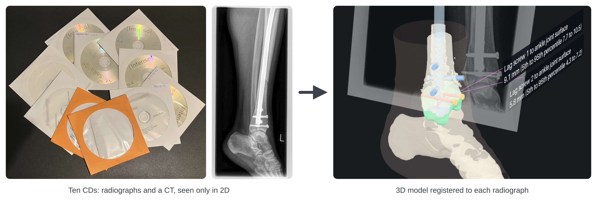
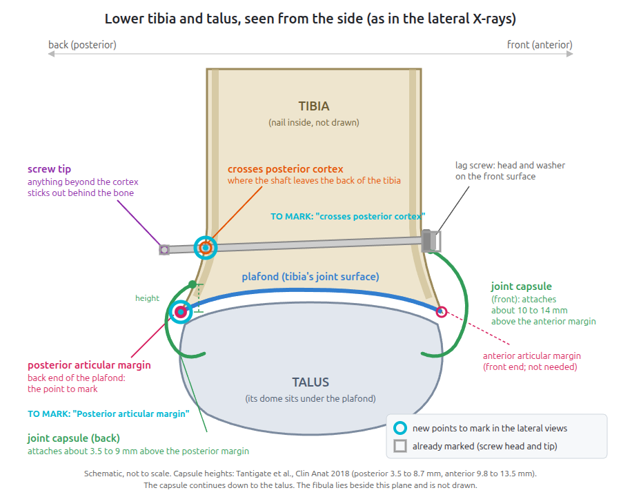
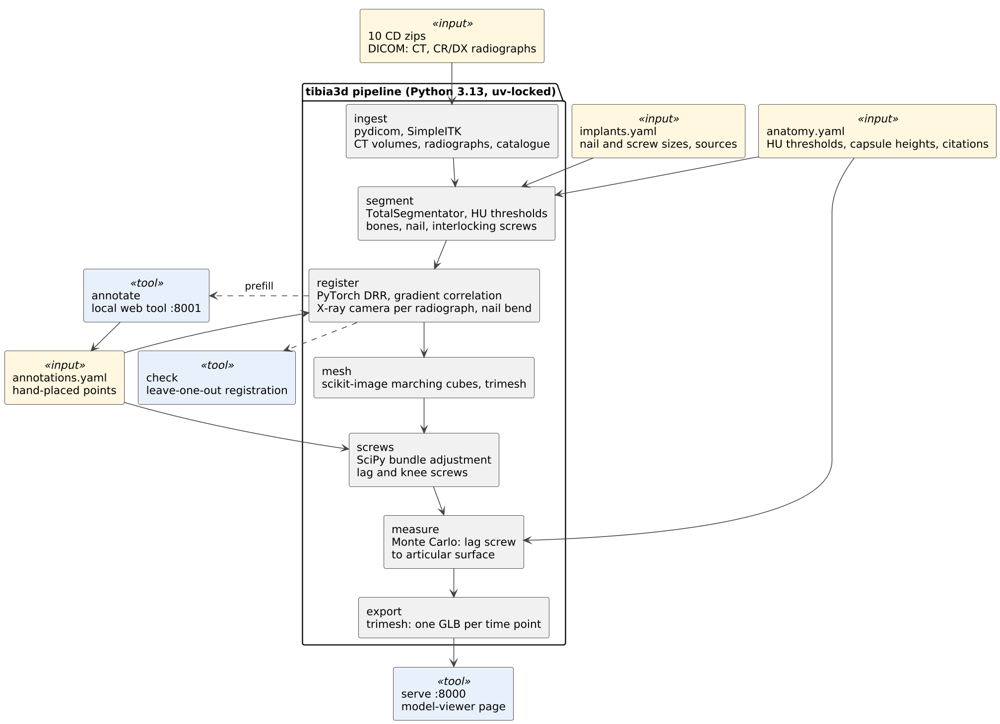
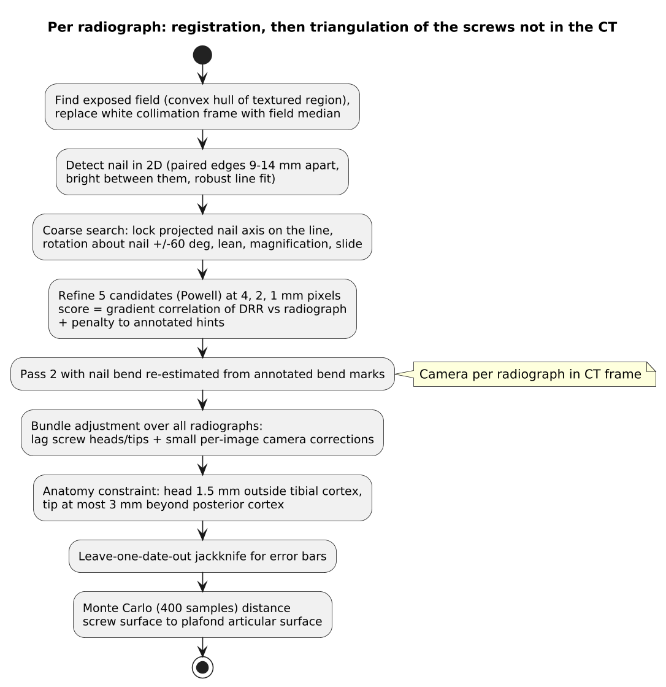

# Ten CDs, one CT and two missing screws: building a 3D model of a leg with Claude Code

## TL;DR

- I had ten CDs of a fractured tibia and fibula (pictured below, left) covering two years of follow-up. They held radiographs that I could only view as flat 2D images, like the lateral view next to them, and a CT that the bundled CD viewer could not show as a 3D model.
- There were two operations. The first implanted an intramedullary tibial nail. During the operation, the posterior malleolus (the back edge of the distal tibia, the "Volkmann fragment") broke off, and a second operation the next day fixed it with two percutaneous lag screws.
- The CD set includes one CT, which carries far more 3D information than any radiograph. It was taken between the two operations, so it shows the nail and its interlocking screws but **not the two lag screws**.
- The lag screws are the implants closest to the ankle joint's articular surface. A screw that enters the joint space can damage the cartilage.
- If a problem ever came up, a doctor would need an MRI to judge how close the lag screws are to the joint surface, for example to decide whether to remove them. This is purely hypothetical. I was curious how far Claude Code could get at reconstructing the tissues and implants in 3D, at placing the lag screws relative to the CT by registration, and at measuring their distance to the joint surface with honest error bars.
- It worked - [view the 3D models here](https://marek-burza.github.io/leg/). The lag screws were triangulated from 27 post-operative radiographs, with each screw end located to within about 1.6 to 1.9 mm. Their closest distances to the tibial plafond's articular surface came out at **9.1 mm [7.7, 10.5]** and **5.8 mm [4.3, 7.2]** (median [5th, 95th percentile]). Neither screw reaches the joint. The Claude Code cost came to about 2.5 EUR.

## Disclaimer first

None of this is a medical assessment. The bone segmentation model (`TotalSegmentator`) is not cleared for diagnostic use, the joint capsule band is drawn from published averages, and the error bars cover the errors I could model, not every error.

## The clinical background, in proper terms

The pre-operative radiographs showed a **spiral fracture of the tibial shaft** in its distal third and a **multi-fragment fracture of the proximal fibula** (near the knee). The tibia was treated with a **reamed, statically locked intramedullary nail**, about 330 mm long and 10 mm in diameter, with **interlocking screws (bolts)** near the ankle and near the knee. The **posterior malleolar fragment** separated during the procedure. A second operation the next day fixed it with **two anterior-to-posterior lag screws**.

The **CT** was taken the morning between the two operations. It consists of a high-resolution ankle scan (0.30 mm pixels) plus a lower-resolution torsion protocol from hip to ankle, which has a gap in the middle. So the CT shows:

- the nail, except for its middle section, which falls in the scan gap,
- the interlocking screws near the ankle,
- the posterior fragment still displaced,
- no lag screws.

Follow-up radiographs (anteroposterior and lateral projections, often an upper and a lower exposure a minute apart) run from two days after surgery until February 2024.

The question I cared about is the distance from each lag screw to the **articular surface of the tibial plafond**, the cartilage-covered roof of the ankle joint that sits on the talar dome. Early in the project I also measured distances to an estimated **joint capsule** attachment band. I later dropped those, because an implant near the capsule's attachment, as opposed to inside the joint, is not a recognised risk to the joint.

## What I learned along the way

Halfway through, I asked the questions any patient would ask: would a specialist recommend removing the implants, and is the joint at risk? The answer, framed explicitly as background for a conversation with a surgeon rather than advice, taught me a few things:

- **Routine removal** of nails and screws in adults without symptoms is generally not recommended in the orthopaedic literature. Removal carries its own risks: infection, nerve injury and refracture. It is considered for specific reasons, such as pain or irritation over a prominent screw head or tip, infection, a broken or loosening implant, or the patient's wish once the bone has healed.
- **Intra-articular screw placement** is the classic danger to cartilage, and it is not the case here: neither lag screw reaches the articular surface (9.1 and 5.8 mm, see *Results*).
- **The capsule** is not a structure the implants endanger simply by being near it.
- What the findings would more plausibly matter for: the lag screw tips stand **1 to 3 mm proud of the posterior cortex**, where tendons run (**flexor hallucis longus** posteriorly, the **peroneal tendons** posterolaterally). Prominent posterior tips can irritate tendons, which is one of the usual reasons to remove a screw *if symptoms occur*.
- Who decides: the surgeon, from symptoms and an examination. The useful thing to bring is the measurements together with the latest radiographs.

I also learned the vocabulary: plafond, posterior articular margin, posterior cortex, tibiofibular recess, Volkmann fragment, end-on projection, digitally reconstructed radiograph. Claude drew a labelled diagram of the ankle (plafond, talus, posterior articular margin, capsule) before asking me to annotate anything on it.

## Choosing the approach: reconstruction vs registration

My first idea was "tomography from the radiographs": take the X-rays from one day at different angles and reconstruct a volume. This would not have worked though:

- **Classical cone-beam reconstruction** needs dozens to hundreds of views over at least 180°. This includes **FDK** (Feldkamp-Davis-Kress), the filtered back-projection used in cone-beam CT, and the iterative methods in `TIGRE` or the `ASTRA Toolbox`. With two views per date the problem is hopelessly underdetermined.
- **ML sparse-view methods** (X2CT-GAN, diffusion models, NeRF and Gaussian-splatting variants) fill in the missing depth with anatomy learned from other people, mostly chests and spines. At the millimetre scale where screw clearance lives, the hallucinated part is exactly what you would be measuring.

A real CT exists, so the sound approach is **2D/3D registration**. You pose the CT-derived model so that its simulated projection matches each radiograph, which recovers each radiograph's X-ray camera. Anything absent from the CT (the lag screws) is then **triangulated** from its positions in many registered radiographs. The trade-off: the bone shapes are always those of March 2022, and healing shows only as a mismatch with the radiograph overlay.

## Library selection criteria

The constraints I set:

1. **As little custom code as possible.** One software engineer (me) has to be able to review all of it.
2. **Prefer the more frequently updated and more downloaded dependency.** A popular library has more eyes on it and is less likely to be abandoned.
3. **Python**, not MATLAB, run through `uv`, with every dependency pinned in a lockfile (since this is my "home turf").
4. Use the local GPU (to accelerate computations).
5. Fully local: no cloud services, no public hosting, and outputs stripped of personal information.

What was picked, and why:

| Task | Library | Why |
|---|---|---|
| Reading DICOM straight from the zips | `pydicom` | The standard DICOM reader for Python. |
| CT volumes, rigid CT-to-CT registration | `SimpleITK`, `nibabel` | The most used medical image toolkits for Python; NIfTI as the interchange format. |
| Bone segmentation | `TotalSegmentator` (`appendicular_bones`, `total` for the femur) | The most used open CT segmenter. It needs a free non-commercial licence, and its usage statistics are switched off. |
| Simulated radiographs (DRRs) on the GPU | `PyTorch`, about 40 lines of our own | **DiffDRR was rejected**: about 1k downloads a month, which is niche, and it has its own coordinate conventions. PyTorch was already installed as a `TotalSegmentator` dependency. |
| Optimisation, bundle adjustment, distance maps | `SciPy` | Ubiquitous. Sparse trust-region least squares did the screw solve in 20 seconds instead of tens of minutes. |
| 2D image work | `OpenCV` (headless), `scikit-image`, `Pillow` | Ubiquitous. Marching cubes comes from scikit-image, and its step size is the mesh size control, so no decimation library is needed. |
| Meshes and glTF export | `trimesh` | The most used Python mesh library. |
| Viewer | Google's `<model-viewer>` web component, version-pinned with a subresource-integrity hash | Started as a `three.js` app and was replaced (see below). |
| Tests | `pytest`, `hypothesis` | Property-based tests for the projection maths. |

**Rejected**: TIGRE and ASTRA (no tomography needed), DiffDRR (popularity), Blender (I wanted something in the browser), and `Node`/`three.js` in the final version.

## Criteria for the software itself

- **Stages with atomic outputs.** Each stage writes to `build/.<stage>.tmp/` and is renamed to `build/<stage>/` only on success, so a crash never leaves half-written results. Stages are skipped when their output exists; `--force` and `all --from <stage>` rebuild selectively.
- **One entry point**: `tibia3d all | <stage> | serve | annotate | check`.
- **Everything derivable from the zipped CDs plus committed configuration.** `config/implants.yaml` holds the implant dimensions, each with its source. `config/anatomy.yaml` holds Hounsfield unit thresholds and capsule heights, each with its citation. `config/annotations.yaml` holds the hand marks. A newcomer's instructions are literally `uv sync --frozen`, set the `TotalSegmentatior` licence, `uv run tibia3d all`.
- **No comments in the code.** The explanations live in the project README, stage by stage: the method, the reason, the numbers and the rejected alternatives. The code is small, with clearly named functions, so it can be audited.
- **Local only.** The servers bind to `127.0.0.1`; nothing is published.
- **A project README written so development can resume later**: known limitations, open problems, rejected experiments with their numbers, and how each was tested.

## Architecture

[PlantUML source](images/architecture.puml)

[PlantUML source](images/registration.puml)

## Making sure it is correct

I asked for a layered, automated verification and validation testing scheme. Many of its parts mirror what medical device software practice (IEC 62304, ISO 14971 risk thinking, the FDA's guidance on software validation) asks for, even though this is a personal project and not a medical device:

- **Intended use and limitations stated up front.** The README opens with "not a medical assessment" and keeps a section of known limitations: the knee screw tips are not determined, the CT predates the revision, the foot poses are unstable, and healing is not modelled.
- **Verification against known answers.**
  - Synthetic round trips: a phantom tibia with a hollow nail and screws is projected at a known camera pose, and registration must recover that pose.
  - Property-based tests (`hypothesis`) for the projection geometry: points project consistently, and detector corners map to image corners.
  - Unit tests for the glTF coordinate frame, label orientation, surface patches and the embedded X-ray camera.
  - Totals: 56 unit tests and 18 data tests.
- **Validation against independent physical references.** The segmented nail measures 10.2 mm in diameter (10.0 mm nominal) and 331 mm long (330 mm nominal), matching the implant record. The data tests run against the real zips and fail if a registration violates its annotated hints by more than 5 mm.
- **Independent hold-out checks.** `tibia3d check` re-registers images *without* their own annotations and reports where the annotated points land. For the screws, every date is left out in turn (a jackknife), which measures the camera error that the fit's covariance cannot see.
- **Uncertainty quantification on every reported number.** Each screw end's error is the larger of the covariance estimate and the leave-one-date-out spread. An end counts as "determined" only when it is seen from two images whose rays differ by at least 10°, with an error of at most 5 mm. Clearances come from 400 Monte Carlo samples, including a 0.5 mm segmentation error, and are reported as a median with the 5th and 95th percentiles. Error sources that are known but not modelled are named: the 39 to 44 mm length spread depends on which constraint you trust.
- **Traceability of inputs.** Every anatomical constant and implant dimension in the configuration carries its literature citation or source document.
- **Reproducibility and configuration management.** All Python dependencies are pinned in `uv.lock` and installed with `--frozen`, and the viewer's only script is pinned by version and SRI hash. A clean rebuild from the zips (63 minutes) reproduced registration, screws, measurements and the viewer scene **byte for byte**.
- **Data protection.**
  - A PII guard test reads the patient's name parts, IDs and birth date from every DICOM file at runtime. It fails if any of them appears in any output file, including inside compressed files, and reports only file names.
  - The radiograph images were checked by eye for burned-in text.
  - `TotalSegmentator`'s usage telemetry is switched off.
- **Rejected experiments recorded with their numbers**, so nobody repeats them blindly.

## Why the hand annotations mattered

I did not plan to annotate anything. It turned out to be the single most important input, for three reasons.

1. **The radiographs are processed for display.** The images on these CDs have local contrast enhancement and saturated metal, so thresholds and normalised template matching do not work. Gradient correlation does, but it leaves some directions weakly determined:
   - a registration can **slide along the nail** and still score well, because the nail's long edges keep matching. One early result had the nail's top 49 mm off.
   - the camera's **rotation about the nail axis** barely changes an AP view of a cylinder.

   A handful of points with about 1 mm precision pins these down: nail top, tip, bend, the point where the nail leaves the image, and the ends of the interlocking screws.
2. **The lag screws are not in the CT.** They were inserted front to back, so AP views see them almost **end-on** and lateral views show them overlapping. With essentially two viewing directions, a single diagonal "screw" explains the images about as well as the real pair. Both automatic intensity fitting and voxel carving converged on that wrong answer. The heads and tips I marked, triangulated jointly across 17 ankle-region views, did not.
3. **Without them, registration fails silently.** In the leave-one-out check most images landed within 1 to 2 mm of their marks without their own annotations, but several lateral views failed badly: 129, 37, 23 and 12 mm off. Nothing in the image score warned about it.

Instead of hand-editing YAML hint files, I proposed a small, throw-away, local annotation tool. Claude built it:

- full-resolution zoom and pan, brightness and contrast,
- point types picked with keys 1 to 9,
- drag to move a point, double-click to delete it,
- every change autosaved atomically,
- the points the current registration predicts are prefilled, so I mostly *moved* points rather than placing them.

Other details came from me:

- Head and tip of each screw are associated within an image, but screws need not correspond between images.
- Missing marks never count as evidence.
- Every annotation is a hint, and hold-out checks are run separately.

## Wrong turns, dead ends and how they were resolved

The interesting part of the session was the route, not the destination.

1. **Metal silhouettes first.** The plan was to anchor registration on thresholded metal outlines (chamfer matching). The processed radiographs have no reliable metal threshold, so that stage was dropped and registration became intensity-based throughout: gradient correlation between a PyTorch DRR and the radiograph.
2. **Matching the fibula instead of the nail.** The 2D nail detector kept locking onto the fibula, which has the same width as the nail. Weighting by brightness did not help. I asked whether removing the white collimation frame would. It would: the frame skewed intensity normalisation. A second bug surfaced in the fix: the saturated nail has no texture, so the exposed-field detector cut it out. Taking the convex hull of the textured region fixed both.
3. **A straight nail through the scan gap.** Several registrations were off by centimetres along the nail. I pointed out that the nail is slightly bent and asked whether the bend could be exploited. The bend lies in the CT's unscanned gap, so the nail is now modelled as two cylinders meeting at a bend. The bend is re-estimated from my annotated bend marks: 34 mm higher than the CT-based guess, at 17.5° rather than 13°.
4. **Rotation about the upper arm of the nail.** On four lateral views the upper tip and the bend matched, but the lower arm diverged by up to half the nail's width. I noted that three points (top tip, bend, and where the nail leaves the image) fix the rotation about the upper arm. "Nail exit" points became an annotation type, and all four aligned.
5. **Annotation semantics.** Claude misread my single-ended marks as "end-on" screws. I clarified that one mark only means the other end is not visible, and the solver was changed so that missing marks are never evidence.
6. **The automatic lag screw search.** Intensity fitting and voxel carving produced one diagonal screw. The fix was a bundle adjustment of screw heads and tips with a small per-image camera correction about the nail, because the registration's weakest direction moves an end-on screw's tip by millimetres.
7. **Lag screws 55 mm long.** After a clean rebuild the lag screws came out about 55 mm long, with one head 18 mm in front of the bone. I knew this could not be right: only the head stands out at the front and at most 1.5 threads at the back. That knowledge became a constraint. A signed distance map of the CT tibia pulls each head to 1.5 mm outside the cortex and allows the tip at most 3 mm beyond it. The screws became 39.1 and 40.9 mm long. The price: side-view cameras turn by up to 41° about the nail, which only the anatomy supports. An alternative (tying paired exposures a minute apart together) gave 43 to 44 mm. I chose the anatomy alone, and the README records the 3 to 5 mm spread as not covered by the error bars.
8. **Fibula as a separate body.** Registering the fibula's pose separately per image, from its faint edges, produced impossible gaps between the tibia and fibula on some images. The fibula is bound to the tibia at both tibiofibular joints and by the interosseous membrane, so it now moves with the tibia. That also helps fix the rotation about the nail.
9. **Experiments that did not help**:
   - pairing exposures (pairs aligned, screws got worse),
   - local refinement in a 40 mm window around the ankle (rotation, depth and magnification trade off; two screw ends lost determination),
   - forcing marked bolt lengths into the registration (side views did not turn; three front views got worse),
   - using the posterior cortex crossings as a third constraint (too few of them; the leave-one-date-out spread grew).
10. **The image refinement that confirmed but was not adopted.** Refining the lag screws as cylinders against all 17 views moved their ends by only 0.6 to 1.1 mm, which confirmed the hand marks to about 1 mm. It was not adopted, because it did not demonstrably reduce the error.
11. **The viewer, twice.**
    - The first viewer was a `three.js` app with toggles, playback, video recording and a view from the X-ray source. In it, the two lag screw heads appeared on opposite sides when the radiograph showed them on the same side, and the clearance lines clipped behind other geometry.
    - Once the question narrowed to "lag screw to articular surface", I removed the capsule distances, the side panels, playback and recording.
    - I asked for one self-contained **glTF file per time point**: fixed opacities, the radiograph embedded on its detector plane, labelled clearances, and an `xray_source` camera. The page became a short static file with `<model-viewer>` and a floating slider.
    - Follow-ups: faded colours and over-opaque bones were corrected. Capsule patches flickered as the leg rotated, which was fixed with patches lifted off the bone surface. Each time point's camera orbit was lost when set before the file swap, so it is now applied after load.
    - A CT isosurface was tried and not added: it hid the patches and added little.

## Results

| | Value |
|---|---|
| Radiographs registered | 27 post-operative, two years |
| Lag screw end error | 1.6 to 1.9 mm (larger of covariance and leave-one-date-out) |
| Lag screw lengths | 39.1 and 40.9 mm (43 to 44 mm under the alternative assumption) |
| Lag screw 1 to articular surface | 9.1 mm [7.7, 10.5] |
| Lag screw 2 to articular surface | 5.8 mm [4.3, 7.2] |
| Knee interlocking screws | heads within about 3.5 mm; tips not determined (about 10 mm) |
| Clean rebuild | 63 min on one GPU, byte for byte reproducible |
| Claude Code cost | about 2.5 EUR |

The viewer shows each time point from its X-ray source, with the radiograph semi-transparent behind the model, so the reconstruction can be judged visually against the image it came from. Drag away from the source view and the leg turns in 3D, showing the nail, the screws, the bones, the joint surfaces in blue and the clearances in magenta.

## Takeaways

- **When a precise modality exists, register to it** instead of reconstructing from sparse views.
- **Domain knowledge beats a cleverer optimiser.** "Only the head sticks out" fixed what four camera experiments could not.
- **A good annotation tool is cheap and decisive.** A few dozen 1 mm points removed failure modes that were otherwise silent.
- **Every reported number needs an error bar and a hold-out check**, and the errors you cannot model belong in writing next to the number.
- **Less code is reviewable code.** Popular dependencies, a ~40 line DRR, no comments but a thorough README, pinned everything.
